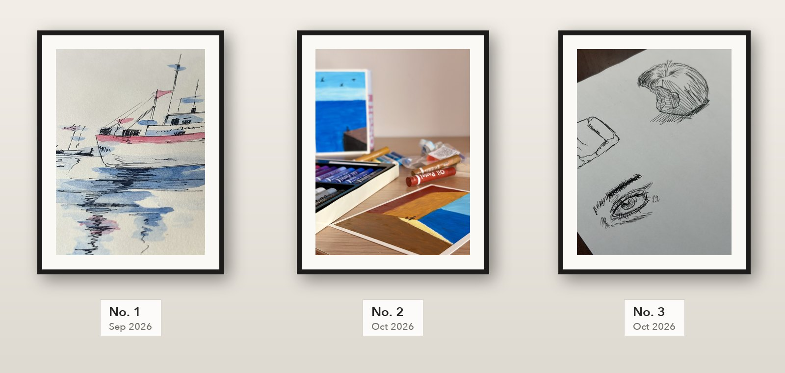
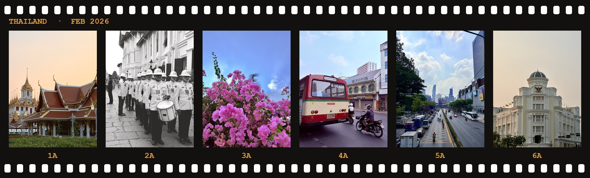
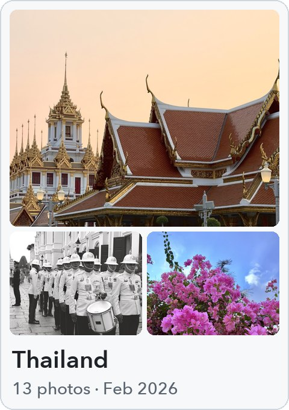
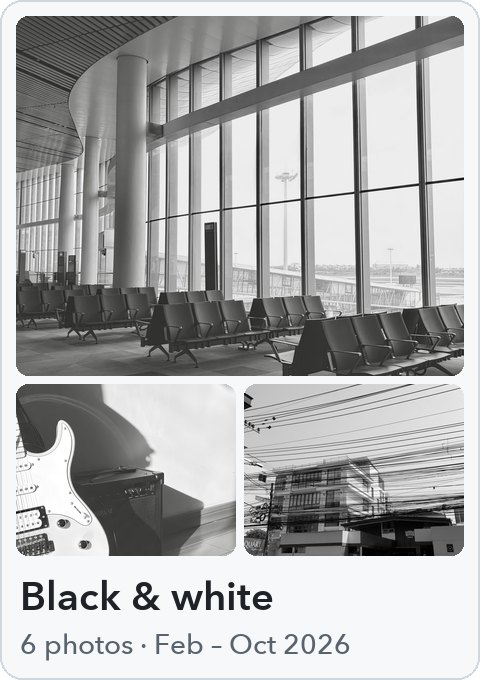
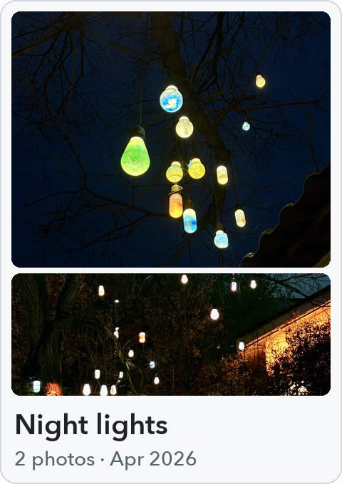
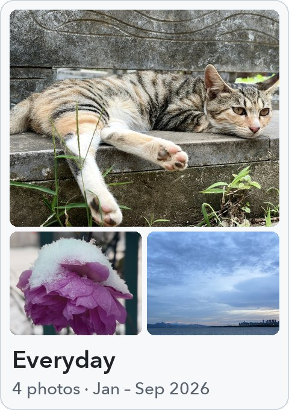

<!-- ART:START -->
## Art

### Sketchbook

<a href="art/README.md"><picture><source media="(prefers-color-scheme: dark)" srcset="art/views/wall-1-dark.jpg"></picture></a>

### Photography

<a href="art/albums/thailand.md"><picture><source media="(prefers-color-scheme: dark)" srcset="art/views/strip-thailand-dark.jpg"></picture></a>

<a href="art/albums/thailand.md"><picture><source media="(prefers-color-scheme: dark)" srcset="art/views/card-thailand-dark.jpg"></picture></a>
<a href="art/albums/black-white.md"><picture><source media="(prefers-color-scheme: dark)" srcset="art/views/card-black-white-dark.jpg"></picture></a>
<a href="art/albums/night-lights.md"><picture><source media="(prefers-color-scheme: dark)" srcset="art/views/card-night-lights-dark.jpg"></picture></a>
<a href="art/albums/everyday.md"><picture><source media="(prefers-color-scheme: dark)" srcset="art/views/card-everyday-dark.jpg"></picture></a>

<!-- ART:END -->
